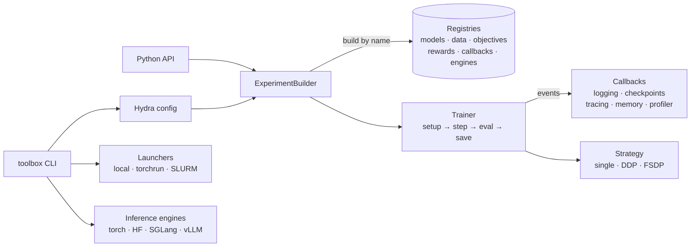
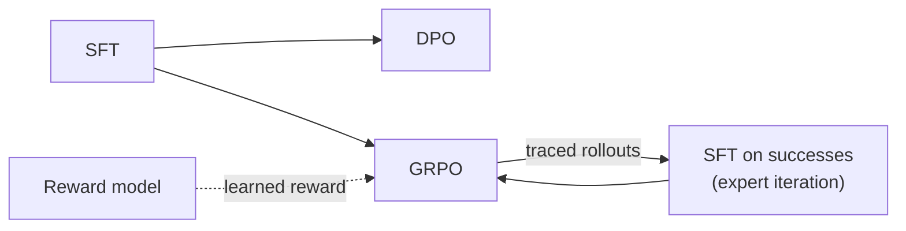

# toolbox

[](https://github.com/lamng3/toolbox/actions/workflows/ci.yml)
[](https://lamng3.github.io/toolbox/)

[](https://creativecommons.org/licenses/by/4.0/)

An extensible toolbox for machine learning research. Every model, loss, layer and training
loop is a swappable component, so testing an idea is a config change. Its first focus is
**post-training and RL** (SFT, DPO, GRPO and friends for language models). It also covers
decision models, agent tracing, GNNs, and SGLang / vLLM serving, and the same command runs on a
laptop, a GPU VM, or a SLURM cluster.

**[Documentation](https://lamng3.github.io/toolbox/)** ·
**[Quickstart](https://lamng3.github.io/toolbox/getting-started/quickstart/)** ·
**[Examples](examples/README.md)** ·
**[Design patterns](https://lamng3.github.io/toolbox/concepts/design-patterns/)** ·
**[Roadmap](https://lamng3.github.io/toolbox/roadmap/)**

## Contents

- [Quick start](#quick-start)
- [Features](#features)
- [Architecture](#architecture)
- [Experiments, recipes and examples](#experiments-recipes-and-examples)
- [Adding a technique](#adding-a-technique)
- [Development](#development)
- [License](#license)

## Quick start

```bash
git clone https://github.com/lamng3/toolbox.git && cd toolbox
uv venv --python 3.11 && uv pip install -e ".[dev]"

toolbox train experiment=sft_tiny                                    # CPU, ~10 s
toolbox train experiment=grpo_tiny model.init_from=runs/sft_tiny/checkpoints/last.pt
```

| Where | Command |
| --- | --- |
| GPU, real model | `uv pip install -e ".[llm]"` then `toolbox train experiment=grpo_qwen_gsm8k` |
| Multi-GPU node | `toolbox launch experiment=sft_qwen launcher=torchrun launcher.nproc_per_node=8` |
| SLURM | `toolbox launch experiment=grpo_qwen_gsm8k launcher=slurm launcher.partition=gpu --dry-run` |
| Any override | `toolbox train experiment=dpo_tiny objective=ipo optimizer.lr=1e-5` |

<details>
<summary>From Python</summary>

```python
from toolbox.experiment import ExperimentBuilder

trainer = (
    ExperimentBuilder("dpo-demo")
    .with_tokenizer("byte")
    .with_data("preference", path="builtin://preference.jsonl")
    .with_model("tiny_gpt", d_model=64, n_layers=2)
    .with_objective("dpo", beta=0.1)
    .with_trainer("preference", max_steps=100, batch_size=16)
    .build()
)
trainer.fit()
```

</details>

## Features

| Area | What's included |
| --- | --- |
| **Post-training** | `sft`, `dpo`, `ipo`, `slic`, `reward_bt` · chain stages with `model.init_from` |
| **Online RL** | `grpo`, `ppo_clip`, `reinforce` × advantages `group_relative`, Dr. GRPO, `rloo` · k3 KL · asymmetric clipping |
| **Rewards** | `exact_match`, `format`, `length_penalty`, composite `weighted_sum`, learned `reward_model`, `llm_judge` |
| **Models** | any Hugging Face causal LM (+ LoRA) · `tiny_gpt` for CPU tests · GCN / GraphSAGE / GAT · actor-critic |
| **Layers** | every block swappable by name: graph convs, MLP heads, norms, activations, attention, feed-forward ([guide](https://lamng3.github.io/toolbox/guides/layers/)) |
| **Decision models** | option probabilities from next-token logits, debiased over rotations · CE / distillation / policy-gradient training |
| **Agent tracing** | atomic `ActionRecord`s with nested spans and delayed feedback · traces → SFT / decision / DPO datasets |
| **Memory** | episodic retrieval (in context) · expert iteration from traced successes (in weights) |
| **GNN** | GraphMAE / GRACE pretraining → node-classification fine-tuning |
| **Serving** | torch, Hugging Face, **SGLang**, **vLLM**, OpenAI-compatible HTTP · `toolbox serve`, `toolbox bench` |
| **Scale-out** | DDP, FSDP, bf16/fp16 · `torchrun` · SLURM with auto-requeue and resume |
| **Observability** | console, JSONL, TensorBoard, W&B · throughput, memory, `torch.profiler` traces |
| **Data** | local JSONL · `builtin://` offline samples · `hf://org/name?split=train` |

Pretraining is only a minimal teaching example. For large-scale pretraining use torchtitan,
Megatron-LM or nanotron, and load their checkpoints here through Hugging Face.

## Architecture



Every technique is a component registered by name and selected from config. The builder
injects dependencies, and the trainer's fixed loop emits events that callbacks observe. Each of
the classic design patterns appears where it does real work; see the
[map from pattern to code](https://lamng3.github.io/toolbox/concepts/design-patterns/).

A typical post-training pipeline, each stage starting from the previous checkpoint:



<details>
<summary>Repository layout</summary>

```
src/toolbox/
├── core/          registry & plugins, events, retry, run context, decorators, constants
├── data/          tokenizers, repositories (local / HF Hub), datasets, collators
├── nn/            layers (attention, RoPE, RMSNorm, SwiGLU, graph convs) and models
├── objectives/    supervised · preference · policy · graph losses
├── rewards/  rl/  decision/  tracing/  memory/
├── trainer/       base loop, trainers, callbacks, optimizers, checkpoints
├── distributed/  serving/  launch/  eval/
├── configs/       the Hydra config tree
├── experiment.py  ExperimentBuilder
└── cli.py         toolbox train | launch | serve | bench | traces | list | config | env
examples/          self-contained techniques built on toolbox
recipes/           end-to-end workflows
docs/              the documentation site
```

</details>

## Experiments, recipes and examples

| Kind | What | Where |
| --- | --- | --- |
| **Experiments** | ready-made configs; the `*_tiny` ones run on CPU in seconds and double as CI tests | `toolbox train experiment=<name>` |
| **Recipes** | multi-stage workflows: RLHF pipeline, self-improvement, agent tracing, custom loss | [`recipes/`](recipes/README.md) |
| **Examples** | techniques built on top of toolbox, one self-contained folder each | [`examples/`](examples/README.md) |

<details>
<summary>All packaged experiments</summary>

| Experiment | What it does | Runs on |
| --- | --- | --- |
| `sft_tiny`, `dpo_tiny`, `reward_model_tiny`, `grpo_tiny` | the RLHF stages on a bundled arithmetic task | CPU |
| `decision_tiny`, `decision_rl_tiny` | decision model via CE / policy gradient | CPU |
| `sft_from_traces` | expert iteration on traced rollouts | CPU |
| `ppo_cartpole` | PPO actor-critic on CartPole | CPU |
| `gnn_pretrain` → `gnn_finetune` | GNN pretraining then node classification | CPU |
| `lm_pretrain_tiny` | minimal next-token pretraining | CPU |
| `sft_qwen`, `dpo_qwen`, `grpo_qwen_gsm8k` | the same recipes on Qwen2.5-0.5B (+LoRA) | GPU |

</details>

## Adding a technique

```python
from toolbox.core.registry import OBJECTIVES
from toolbox.objectives.base import PreferenceObjective

@OBJECTIVES.register("my_preference_loss")
class MyLoss(PreferenceObjective):
    def __call__(self, policy_chosen, policy_rejected, ref_chosen, ref_rejected): ...
```

Select it with `objective=my_preference_loss`. Layers work the same way: register a module
under its role (for example `@MLPS.register("my_head")`) and use `model.head=my_head`. See
[Swapping layers](https://lamng3.github.io/toolbox/guides/layers/). To share it across projects, publish it under
the `toolbox.plugins` entry point; see
[Extending](https://lamng3.github.io/toolbox/guides/extending/). Paper reproductions go in
[`examples/`](examples/README.md).

## Development

```bash
uv pip install -e ".[dev,docs]"
make check        # ruff + mypy + pytest + strict docs build, same as CI
make docs-serve   # live docs at http://127.0.0.1:8000
```

See [CONTRIBUTING.md](CONTRIBUTING.md).

## License

[CC BY 4.0](LICENSE). Copyright (c) 2026 Lam Nguyen.
