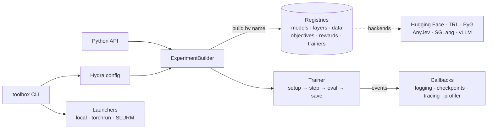

# toolbox

[](https://github.com/lamng3/toolbox/actions/workflows/ci.yml)
[](https://lamng3.github.io/toolbox/)

[](https://creativecommons.org/licenses/by/4.0/)

An extensible toolbox for machine learning research. Every model, layer, loss, reward and
training loop is a component you select by name, so trying an idea is a config change and
comparisons stay fair. Standard libraries (Hugging Face, TRL, PyTorch Geometric, AnyJev,
SGLang, vLLM) plug in as backends instead of being rewritten. It ships components for
language models, RL, decision models, agents, GNNs and serving, and you can add your own for
anything else.

**[Documentation](https://lamng3.github.io/toolbox/)** ·
**[Quickstart](https://lamng3.github.io/toolbox/getting-started/quickstart/)** ·
**[Research workflow](https://lamng3.github.io/toolbox/getting-started/research/)** ·
**[Examples](examples/README.md)** ·
**[Roadmap](https://lamng3.github.io/toolbox/roadmap/)**

## Contents

- [Install](#install)
- [How to use it](#how-to-use-it)
- [What's included](#whats-included)
- [Examples](#examples)
- [How it fits together](#how-it-fits-together)
- [Development](#development)
- [License](#license)

## Install

```bash
git clone https://github.com/lamng3/toolbox.git && cd toolbox
uv venv --python 3.11 && uv pip install -e ".[dev]"
toolbox env                          # versions, GPUs, which backends are installed
```

Backends are optional extras: `.[llm]` (Hugging Face, TRL, PEFT), `.[gnn]` (PyTorch
Geometric), `.[jev]` (AnyJev), `.[serve-vllm]`, `.[serve-sglang]`, `.[tracking]`, `.[rl]`.
See [Installation](https://lamng3.github.io/toolbox/getting-started/installation/).

## How to use it

**Run an experiment.** Every packaged experiment has a tiny version that runs on a CPU in
seconds, and a real one for a GPU:

```bash
toolbox train experiment=sft_tiny                       # CPU, seconds
toolbox train experiment=grpo_qwen_gsm8k                # one GPU, Qwen2.5-0.5B + LoRA
toolbox launch experiment=grpo_qwen_gsm8k launcher=slurm launcher.gpus_per_node=4
```

**Change anything from the command line.** Components are swapped by name:

```bash
toolbox train experiment=dpo_tiny objective=ipo optimizer.lr=1e-5     # another loss
toolbox train experiment=gnn_pretrain model.conv=pyg_gat              # a PyG layer
toolbox train experiment=grpo_qwen_gsm8k trainer.name=trl trainer.algorithm=grpo   # TRL
toolbox list objective                                                # what's available
```

**Add your own idea** as a registered component in your own folder, then select it by name.
Toolbox's data, training loop, logging, checkpoints and launchers are reused unchanged:

```python
from toolbox.core.registry import OBJECTIVES
from toolbox.objectives.base import PreferenceObjective

@OBJECTIVES.register("my_loss")
class MyLoss(PreferenceObjective):
    def __call__(self, policy_chosen, policy_rejected, ref_chosen, ref_rejected): ...
```

```bash
toolbox train --config-dir my_idea/configs experiment=my_idea      # imports: [my_idea.losses]
```

The [research workflow](https://lamng3.github.io/toolbox/getting-started/research/) walks
through the whole loop: baseline → change one thing → compare runs → add a component → scale
to a cluster → write it up as an example.

<details>
<summary>The same from Python</summary>

```python
from toolbox.experiment import ExperimentBuilder

trainer = (
    ExperimentBuilder("dpo-demo")
    .with_tokenizer("byte")
    .with_data("preference", path="builtin://preference.jsonl")
    .with_model("tiny_gpt", d_model=64, n_layers=2)
    .with_objective("dpo", beta=0.1)
    .with_trainer("preference", max_steps=100, batch_size=16)
    .build()
)
trainer.fit()
```

</details>

## What's included

| Area | Components |
| --- | --- |
| **Post-training** | SFT · DPO, IPO, SLiC · Bradley–Terry reward models · TRL backend · stages chained with `model.init_from` |
| **Online RL** | GRPO, PPO-clip, REINFORCE × group-relative, Dr. GRPO, RLOO advantages · PPO with GAE for environments |
| **Rewards** | exact match, format, length penalty, weighted sums, learned reward model, LLM judge |
| **Models and layers** | any Hugging Face causal LM (+ LoRA) · GCN / GraphSAGE / GAT and any PyG layer · any `nn.Module` · every layer [swappable by name](https://lamng3.github.io/toolbox/guides/layers/) |
| **Decision models** | option probabilities from next-token logits, debiased over option orders · CE, distillation, policy-gradient training |
| **Agents** | action tracing with delayed rewards · traces → SFT / decision / DPO data · episodic memory and expert iteration |
| **GNN** | GraphMAE / GRACE pretraining → node classification |
| **Serving** | torch, Hugging Face, SGLang, vLLM, OpenAI-compatible HTTP · `toolbox serve`, `toolbox bench` |
| **Scale-out** | DDP, FSDP, bf16 / fp16 · torchrun · SLURM with automatic requeue and resume |
| **Tracking** | console, JSONL, TensorBoard, W&B · throughput, memory, `torch.profiler` |
| **Data** | local JSONL · `builtin://` offline samples · `hf://org/name?split=train` |

Every selectable name is in the generated
[component catalog](https://lamng3.github.io/toolbox/concepts/components/).

## Examples

Each example is a self-contained folder with its code, configs, tests and README:

| Example | What it shows |
| --- | --- |
| [Recipes](examples/recipes/) | RLHF pipeline, self-improvement, agent tracing, custom losses and layers |
| [GMV](examples/gmv/) | serving GNN outputs as views via L-bisimulation (Fan et al., 2025) |
| [Jev](examples/jev/) | training decision models: a 0.5B student gives a 1.5B teacher's decisions in one forward pass (with [AnyJev](https://github.com/nokia-applied-research/AnyJev)) |

## How it fits together



A config names each component; the builder creates it from its registry and injects what it
needs; the trainer runs a fixed loop and emits events that callbacks handle. The code is also
a reference for classic design patterns, each [mapped to where it is
used](https://lamng3.github.io/toolbox/concepts/design-patterns/).

<details>
<summary>Repository layout</summary>

```
src/toolbox/
├── core/          registries and plugins, events, retry, run context, constants
├── data/          tokenizers, data sources (local / builtin / HF Hub), datasets, collators
├── nn/            layers by role and models built from them; PyG and HF adapters
├── objectives/    supervised · preference · policy · graph losses
├── rewards/  rl/  decision/  tracing/  memory/
├── trainer/       base loop, trainers (incl. TRL), callbacks, optimizers, checkpoints
├── distributed/  serving/  launch/  eval/
├── configs/       the Hydra config tree (experiments, models, objectives, ...)
├── experiment.py  ExperimentBuilder
└── cli.py         toolbox train | launch | serve | bench | traces | list | config | env
examples/          recipes and research examples, one folder each
docs/              the documentation site
tests/             unit tests and end-to-end tiny experiments
```

</details>

## Development

```bash
uv pip install -e ".[dev,docs]"
make check        # ruff + mypy + pytest + strict docs build, same as CI
make docs-serve   # live docs at http://127.0.0.1:8000
```

See [CONTRIBUTING.md](CONTRIBUTING.md).

## License

[CC BY 4.0](LICENSE). Copyright (c) 2026 Lam Nguyen.
