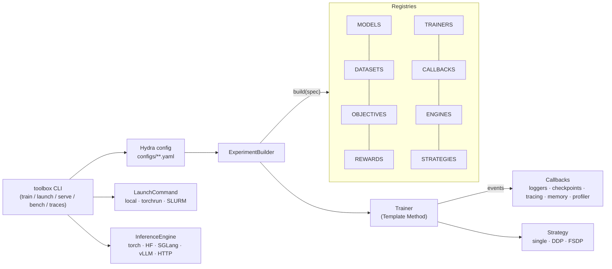

# Architecture

## The big picture



## Package layout

```
src/toolbox/
├── core/          registry (plugins + factory), events (observer), retry, run context (singleton),
│                  decorators, constants, env/device/seed helpers
├── data/          tokenizers, repositories (local / HF Hub), dataset factories, collators
├── nn/            layers registered by role (graph_conv, mlp, norm, activation, feedforward,
│                  attention) and models whose slots take layer specs
├── objectives/    losses grouped by family: supervised, preference, policy, graph
├── rewards/       verifiable, composite, learned, LLM-judge rewards
├── rl/            advantage estimators, text rollouts, environments, buffers
├── decision/      AnyJev-style decision readout + decision training objectives
├── tracing/       ActionRecord, Tracer, trace stores, trace → dataset conversion
├── memory/        episodic memory store, embedders, memory-writer callback
├── trainer/       BaseTrainer + supervised / preference / grpo / ppo_env trainers, callbacks,
│                  optimizers & schedulers, precision, checkpoints
├── distributed/   distribution strategies
├── serving/       inference engines, OpenAI-compatible server, benchmark
├── launch/        local / torchrun / SLURM launch commands
├── eval/          standalone evaluators
├── configs/       the Hydra config tree (shipped inside the package)
├── experiment.py  ExperimentBuilder, load_config, run_experiment
├── catalog.py     renders the component catalog for the docs
└── cli.py         the `toolbox` command

examples/<name>/   recipes and research examples built on toolbox (code, configs, tests, README)
docs/              this site; the API reference and component catalog are generated
```

Established libraries (Hugging Face, TRL, PyTorch Geometric, AnyJev, SGLang, vLLM ...) plug in
as backends behind the same interfaces; see [Standard libraries first](backends.md).

Every name you can select in a config is listed in the
[component catalog](components.md), which is generated from the registries when the docs are
built.

## The lifecycle of `toolbox train`

1. **Compose config.** `load_config(overrides)` merges `configs/config.yaml`, the selected
   groups (`model=`, `data=`, ...), the `experiment=` file and command-line overrides.
2. **Build.** `ExperimentBuilder.from_config(cfg).build()` instantiates each component through
   its registry and *injects* dependencies:
    * tokenizer → dataset factory,
    * `vocab_size`, data facts (`in_dim`, `num_classes`) and env facts (`obs_dim`,
      `num_actions`) → model, but only the ones its constructor accepts,
    * model parameters → optimizer → scheduler,
    * everything → `TrainerClass.from_builder(...)`.
3. **Fit.** `BaseTrainer.fit()` runs a fixed skeleton:

    ```
    _prepare_run   write config.yaml · resume (resume_from=auto) · setup()
    loop:
      STEP_START → train_step() → STEP_END(metrics)     # subclasses customise train_step
      every eval_every → evaluate() → EVAL_END
      every save_every → save_checkpoint() → CHECKPOINT_SAVED
    _finish        final eval · final checkpoint · FIT_END
    ```

4. **Observe.** Callbacks subscribe to those events: console/JSONL/W&B logging, early stopping,
   throughput, memory, the profiler, rollout sampling, trace logging, memory writing. The loop
   itself never logs or saves anything directly.

## The trainers

| Trainer | `train_step` | Objective family |
| --- | --- | --- |
| `supervised` | grad-accumulated `objective(model, batch)` | `SupervisedObjective` |
| `preference` | log-probs of chosen/rejected under policy and frozen reference | `PreferenceObjective` |
| `grpo` | rollout → reward → advantage → `ppo_epochs` × clipped update | `PolicyObjective` |
| `ppo_env` | env rollout → GAE → minibatch PPO epochs (actor + critic) | built-in clipped loss |

Each family is a small abstract interface in `toolbox.objectives.base`. A trainer checks that
the configured objective belongs to its family and fails fast with a readable error if it
does not.
