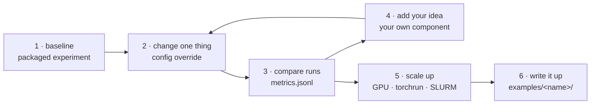

# Research workflow

toolbox is built for the research loop: start from a working baseline, change one thing, compare,
and scale up only what works. This page walks through that loop. Each step uses the same
configs and commands, from a laptop CPU to a SLURM cluster.



## 1. Start from a baseline

Pick the packaged experiment closest to your question and run its tiny version first. It
finishes in seconds on a CPU, so you know the pipeline is wired correctly before spending GPU
time.

```bash
toolbox train experiment=dpo_tiny            # see all of them: Quickstart → Packaged experiments
toolbox config experiment=dpo_tiny           # the full config it ran with
```

## 2. Change one thing

Every component is selected by name, so most ideas start as an override:

```bash
toolbox train experiment=dpo_tiny objective=ipo                        # another loss
toolbox train experiment=grpo_tiny advantage=rloo                      # another estimator
toolbox train experiment=gnn_pretrain model.conv=gat model.norm=layernorm   # other layers
toolbox train experiment=grpo_qwen_gsm8k trainer.name=trl trainer.algorithm=grpo   # TRL
```

`toolbox list` shows every registered name, and the
[component catalog](../concepts/components.md) shows them with their presets.

## 3. Compare runs

Each run writes `config.yaml` (exactly what ran) and `metrics.jsonl` (one line per log or eval)
to its `output_dir`. Give each variant its own directory, and loop over seeds:

```bash
for loss in dpo ipo slic; do
  for seed in 0 1 2; do
    toolbox train experiment=dpo_tiny objective=$loss seed=$seed output_dir=runs/loss/$loss-s$seed
  done
done
```

```python
import json, pathlib

for run in sorted(pathlib.Path("runs/loss").iterdir()):
    evals = [json.loads(l) for l in (run / "metrics.jsonl").open() if '"split": "eval"' in l]
    print(run.name, evals[-1])
```

Add `{name: wandb}` or `{name: tensorboard}` to `callbacks` for dashboards.

## 4. Add your idea

When an override isn't enough, write the new piece as a component. Everything else (data,
training loop, logging, checkpoints, launchers) stays the same, so the comparison stays fair.

| Your idea is a ... | Write | Select with |
| --- | --- | --- |
| loss | a class with `@OBJECTIVES.register("my_loss")` | `objective=my_loss` |
| layer or head | a module with `@MLPS.register(...)`, `@GRAPH_CONVS.register(...)`, ... | `model.head=my_head` ([guide](../guides/layers.md)) |
| model | any `nn.Module`, nothing to register | `model: {name: torch_module, target: my_project.models:MyNet}` |
| reward | a `Reward` with `@REWARDS.register(...)` | `reward=my_reward` |
| dataset | a factory with `@DATASETS.register(...)` | `data.name=my_data` |
| training algorithm | a `BaseTrainer` subclass ([guide](../guides/extending.md#a-new-training-paradigm)) | `trainer.name=my_trainer` |

Keep the project in one folder, with your configs next to your code:

```
examples/my_idea/            # or a folder in your own repository
├── README.md                # question, method, results
├── losses.py                # @OBJECTIVES.register("my_loss") ...
├── configs/experiment/my_idea.yaml
└── tests/test_my_idea.py
```

```yaml title="examples/my_idea/configs/experiment/my_idea.yaml"
# @package _global_
defaults:
  - /experiment/dpo_tiny      # start from a packaged experiment

name: my_idea
imports: [examples.my_idea.losses]   # registers your components before the run is built
objective: {name: my_loss, beta: 0.1}
```

```bash
toolbox train --config-dir examples/my_idea/configs experiment=my_idea
toolbox train --config-dir examples/my_idea/configs experiment=my_idea objective.name=dpo   # baseline
```

`imports` lists the modules that register your components. The `toolbox` command imports them
before building the run, from the current directory too, so the same config works with
`toolbox launch` and on SLURM. For multi-stage work (teacher → student, train → evaluate), write
a `run.py` that calls `load_config(..., config_dir=...)` and `ExperimentBuilder`, as
[`examples/jev/run.py`](https://github.com/lamng3/toolbox/blob/main/examples/jev/run.py) does.

## 5. Scale up

Switch the model and the launcher. The rest of the config stays the same:

```bash
toolbox train --config-dir examples/my_idea/configs experiment=my_idea \
    model=qwen2_5_0_5b_lora tokenizer=qwen2_5 trainer.precision=bf16  # one GPU
toolbox launch --config-dir examples/my_idea/configs experiment=my_idea \
    launcher=slurm launcher.gpus_per_node=4 --dry-run                 # a cluster
```

See [GPU VMs and SLURM](hpc.md) for multi-GPU, preemption and sweeps.

## 6. Write it up

When the result holds, make the folder a proper example: a README with the question, method,
citation, results table and what is not covered; a test that runs in seconds with a tiny model;
and a row in `examples/README.md`. The README then appears under
[Examples](../examples/index.md) on this site. [GMV](../examples/gmv.md) and
[Jev](../examples/jev.md) are complete examples to copy.
