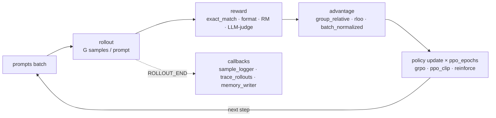

# Online RL for language models

The `grpo` trainer implements the online RL loop used by GRPO, Dr. GRPO, RLOO and PPO-style
methods:



## The three axes

Methods in the literature differ along three independent choices, and each is a config group:

| Axis | Options | Config |
| --- | --- | --- |
| Reward | `exact_match`, `format`, `length_penalty`, `weighted_sum`, `reward_model`, `llm_judge` | `reward=` |
| Advantage | `group_relative` (GRPO), `dr_grpo` (no std scaling), `rloo`, `batch_normalized` | `advantage=` |
| Policy loss | `grpo` (clip + k3 KL, per-sequence mean), `ppo_clip` (token mean, no KL), `reinforce` | `objective=` |

Combinations:

```bash
toolbox train experiment=grpo_tiny                                   # GRPO
toolbox train experiment=grpo_tiny advantage=dr_grpo objective.loss_agg=token_mean  # Dr. GRPO
toolbox train experiment=grpo_tiny advantage=rloo objective=reinforce               # RLOO
toolbox train experiment=grpo_tiny objective.clip_eps_high=0.28      # DAPO clip-higher
```

## Losses

With importance ratio $\rho_t = \pi_\theta(o_t)/\pi_{\text{old}}(o_t)$ and advantage $A$:

$$
\mathcal{L} = -\min\big(\rho_t A,\ \text{clip}(\rho_t, 1-\epsilon_\text{low}, 1+\epsilon_\text{high}) A\big) + \beta\, \mathbb{D}_\text{KL}^{k3}
$$

where the k3 estimator is $\mathbb{D}^{k3} = e^{r} - r - 1$ with $r = \log\pi_\text{ref} - \log\pi_\theta$.
`loss_agg=seq_mean_token_mean` averages within each sequence first (original GRPO).
`token_mean` weights all tokens equally (DAPO / Dr. GRPO).

## Rewards

Verifiable rewards compare the completion with the dataset's `answer` field:

```yaml
reward:
  name: weighted_sum
  components:
    - {name: exact_match, extract: last_number, weight: 1.0}
    - {name: format, pattern: "<answer>.*</answer>", weight: 0.1}
    - {name: length_penalty, target_chars: 300, weight: 0.05}
```

`llm_judge` asks any inference engine (SGLang / vLLM / HTTP) to grade answers. `reward_model`
loads a Bradley–Terry checkpoint.

## Real models

```bash
toolbox train experiment=grpo_qwen_gsm8k                  # Qwen2.5-0.5B + LoRA on GSM8K, 1 GPU
toolbox launch experiment=grpo_qwen_gsm8k launcher=slurm launcher.gpus_per_node=4
```

!!! info "Generation backend"
    Rollouts currently use the policy's own `generate` (in-process). For large models and long
    completions generation dominates step time. The `serving` adapters (SGLang, vLLM) are where
    a dedicated rollout engine with weight syncing plugs in. That is the next item on the
    [roadmap](../roadmap.md).

## Inspecting runs

* `samples.jsonl` holds a few prompts, completions and rewards every N steps (`sample_logger`).
* `traces/actions.jsonl` holds every rollout as an action record (`trace_rollouts`). Summarise
  it with `toolbox traces runs/<run>/traces`.
* `metrics.jsonl` holds `reward_mean`, `reward_std`, `kl`, `clip_fraction`, `completion_tokens`,
  `grad_norm`, `eval/reward`.

!!! tip "Production runs"
    The same config runs on [TRL](trl.md) with `trainer.name=trl trainer.algorithm=grpo`.
    TRL is the standard post-training library; the built-in trainer is the readable reference.
