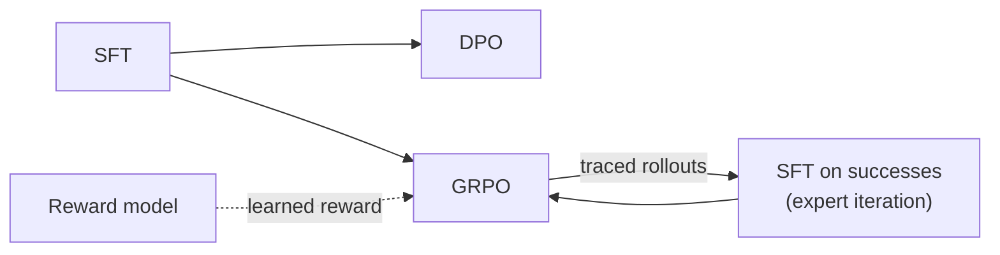

# toolbox

**toolbox** is an extensible toolbox for machine learning research: a library and template for
getting from an idea to experiment results quickly. Every model, loss, layer and training loop
is a swappable component. Its first focus is **post-training and RL** (SFT, DPO, GRPO and other
RL methods for language models). It also covers AnyJev-style **decision models**, **agent
tracing** (log actions, then train on them), memory-driven self-improvement, GNN
pre-/post-training, and SGLang/vLLM serving.

Plug in a GPU, run one command, get results. The same command runs on a laptop CPU, a cloud VM, or a
SLURM cluster.

```bash
toolbox train experiment=grpo_tiny                                    # laptop, seconds
toolbox train experiment=grpo_qwen_gsm8k                              # one GPU
toolbox launch experiment=grpo_qwen_gsm8k launcher=slurm launcher.gpus_per_node=4   # HPC
```

<div class="grid cards" markdown>

- **Post-training**

    ---

    SFT, DPO / IPO / SLiC, Bradley–Terry reward models, GRPO / Dr. GRPO / RLOO / PPO with
    verifiable, learned or LLM-judge rewards.

    [:octicons-arrow-right-24: Online RL guide](guides/grpo.md)

- **Decision models**

    ---

    Typed questions answered with calibrated option probabilities, debiased by option
    rotation, trainable by CE, self-distillation or policy gradient.

    [:octicons-arrow-right-24: Decision models](guides/decision-models.md)

- **Agent tracing → training data**

    ---

    Every decision, tool call and generation is an atomic `ActionRecord`. Attach rewards
    later, then train on the log.

    [:octicons-arrow-right-24: Tracing](guides/tracing.md)

- **Built to be extended**

    ---

    Every technique is a registered component behind a small interface. Add yours from your
    own package and it shows up in the CLI and configs.

    [:octicons-arrow-right-24: Extending](guides/extending.md)

- **Examples from papers**

    ---

    Self-contained techniques built on toolbox, each with its code, configs, tests and a
    citation. The first is GMV: serving GNN outputs as views.

    [:octicons-arrow-right-24: Examples](examples/index.md)

</div>

## What's supported

| Area | Components |
| --- | --- |
| Post-training objectives | `sft`, `dpo`, `ipo`, `slic`, `reward_bt`, `grpo`, `ppo_clip`, `reinforce` |
| Advantage estimators | `group_relative` (GRPO), `dr_grpo` (unscaled), `rloo`, `batch_normalized`, GAE |
| Rewards | `exact_match`, `format`, `length_penalty`, `weighted_sum` (composite), `reward_model`, `llm_judge` |
| Models | any Hugging Face causal LM (+ LoRA via PEFT), `tiny_gpt` (Llama-style, from scratch), reward model, GNNs (GCN / GraphSAGE / GAT), actor-critic |
| Layers | every block is [swappable by name](guides/layers.md): graph convs, MLP heads, norms, activations, attention, feed-forward, built-in or your own |
| Decision models | rotation-debiased readout, `decision_ce`, `decision_distill`, `decision_pg`, flip-rate evaluation |
| Agents | `Tracer` spans, `@traced`, delayed feedback, trace → SFT / decision / preference datasets, episodic memory |
| GNN | self-supervised pretraining (`masked_feature` GraphMAE, `graph_contrastive` GRACE) → node classification |
| Classic RL | PPO with GAE on Gymnasium-style environments (built-in CartPole) |
| Serving | in-process torch, Hugging Face, **SGLang**, **vLLM**, any OpenAI-compatible server; benchmark CLI |
| Scale-out | single device, DDP, FSDP; `torchrun`; SLURM with auto-requeue and resume |
| Tracking | console, JSONL, TensorBoard, Weights & Biases, throughput, memory, `torch.profiler` traces |
| Data | local JSONL, `builtin://` offline samples, `hf://org/name?split=train` Hub datasets |

The [component catalog](concepts/components.md) lists every selectable name and config preset.
It is generated from the code, so it is always complete.

## A typical pipeline

Each stage starts from the previous stage's checkpoint (`model.init_from`):



## Design

The code base also teaches software design. Each of the classic refactoring and design patterns
(Strategy, Factory, Dependency Injection, Observer, Plugin, Repository, Singleton, Decorator,
Adapter, Builder, Template Method, Command, ...) appears where it does real work. Each one is
mapped to the code on the [design patterns](concepts/design-patterns.md) page.

!!! note "Scope"
    The focus is post-training and RL. Pretraining is included only as a minimal teaching
    example. For large-scale pretraining use torchtitan, Megatron-LM or nanotron.
