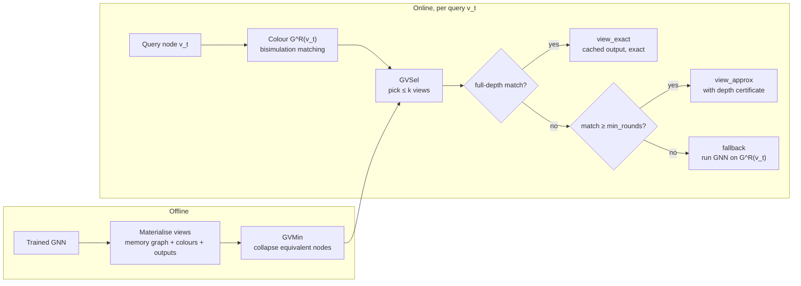
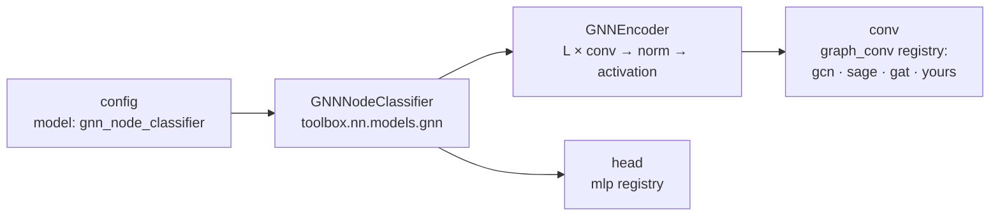

# GMV: serving graph-model outputs as views

This example implements the core ideas of **graph model views (GMVs)** on top of toolbox. Past
GNN inference results are kept as queryable "views". A new node-level query is answered from a
*bisimilar* counterpart in those views, instead of rerunning the model over the full graph.

> Yangxin Fan, Mingjian Lu, Haolai Che, Yinghui Wu. *Approximating Graph Inference by Serving
> Graph Model Outputs as Views* (repository title: *Scaling Graph Inference by Serving Models as
> Views*). Case Western Reserve University, 2025. Code and paper:
> <https://github.com/Yangxin666/GMV>

```bibtex
@misc{fan2025gmv,
  title  = {Approximating Graph Inference by Serving Graph Model Outputs as Views},
  author = {Fan, Yangxin and Lu, Mingjian and Che, Haolai and Wu, Yinghui},
  year   = {2025},
  note   = {Case Western Reserve University. Code: https://github.com/Yangxin666/GMV},
  url    = {https://github.com/Yangxin666/GMV}
}
```

> **Provenance.** This is an **independent re-implementation** written from the paper. No
> upstream code is copied, because the upstream repository has no license. It is not affiliated
> with or endorsed by the authors. If the paper is published at a venue, cite that version
> instead (the repository does not name one as of 2025-10).

## Run it

```bash
python -m examples.gmv.run                                   # GCN, exact answers only
python -m examples.gmv.run --min-rounds 2                    # allow certified approximations
python -m examples.gmv.run model.conv=sage --views 1000      # any toolbox override works
toolbox traces runs/gmv/traces                               # per-variant routes and latency
pytest examples/gmv                                          # the exactness checks
```

## How it works



## The model

GMV serves the outputs of a GNN, and that GNN comes from toolbox; the example doesn't define
one. [`configs/experiment/gmv_molecules_gcn.yaml`](configs/experiment/gmv_molecules_gcn.yaml)
selects `model: gnn_node_classifier`, which `ExperimentBuilder` builds from the toolbox model
registry:



Each slot is a layer spec, so the architecture changes from the command line:

```bash
python -m examples.gmv.run model.conv=sage                         # GraphSAGE instead of GCN
python -m examples.gmv.run 'model.conv={name:gat,heads:8}'         # GAT with 8 heads
python -m examples.gmv.run 'model.head={name:mlp,hidden_dims:[32]}' model.norm=layernorm
```

A layer you write yourself plugs in the same way. Register it in the matching toolbox registry
and select it by name:

```python
from torch import nn
from toolbox.core.registry import GRAPH_CONVS


@GRAPH_CONVS.register("my_conv")
class MyConv(nn.Module):
    def __init__(self, in_dim: int, out_dim: int): ...
    def forward(self, x, edge_index): ...
```

GMV's matching uses `L` refinement rounds for `sage` and `gat`, and `L + 1` for `gcn` and for
any other layer, including yours. That's the safe default, because extra rounds only make
matching stricter.

## How the paper maps onto toolbox

| Paper | Here | Toolbox piece used |
| --- | --- | --- |
| GNN `M` over graph `G` | 2-layer GCN / GraphSAGE / GAT node classifier | `gnn_node_classifier`, trained by `ExperimentBuilder` from [`configs/experiment/gmv_molecules_gcn.yaml`](configs/experiment/gmv_molecules_gcn.yaml) via `--config-dir` |
| Memory graphs, molecular motivation | disjoint union of random molecules; *public* molecules feed views, *private* ones are queried | dataset `gmv_molecules` registered in `DATASETS` ([`data.py`](data.py)) |
| Embedding-respecting L-bisimulation `R^L` | graded colour refinement with stable hashes ([`bisim.py`](bisim.py)) | — |
| GMV `V = (G_V, T_V, Z_V)`, extension | `GraphModelView`, `materialize_view` ([`views.py`](views.py)) | — |
| GVSel (Alg. 2) + forgetting cache | `gvsel`, `gvsel_forgetting`, `random` ([`selection.py`](selection.py)) | a `Registry` of strategies |
| GVMin (Alg. 3) | `minimize`: collapse inference-equivalent nodes | — |
| GVInf / online workflow (Alg. 1, Sec. III-B) | `GMVService.answer`: match → select → exact / approximate / fallback ([`service.py`](service.py)) | every query logged as an `ActionRecord` with `Tracer` |
| Upstream scripts `GVInf`, `GVInf-all`, `GVInf-ran`, `GVInf-nomin` | the variants in [`run.py`](run.py), plus a `local` baseline | — |

### The exactness condition, checked

Two nodes are L-bisimilar when they have the same features and their neighbourhoods match
recursively for L hops. For a deterministic L-layer GNN, they then get the same output
(Corollary 4), so a view's cached output answers the query *exactly*. We compute this with
**counting** colour refinement, where neighbour multisets play the role of the paper's scaling
factors `S_e`. `tests/test_gmv.py` checks the condition on real model outputs:

| Layer | Rounds needed | Max output gap within a colour class |
| --- | --- | --- |
| GraphSAGE (mean), GAT | L | ≤ 1.5e-8 |
| GCN | L + 1 | 1.5e-8 (vs **4.7e-3** with only L rounds) |

GCN normalises each message by the *neighbour's* degree, so it also depends on the degrees of
nodes L hops away. That needs one more round. The paper handles this with stored degree
metadata (its Table I); the extra round is the metadata-free equivalent.

## Results

400 private-molecule queries, 1,000 views, budget k = 5. Each GNN is trained for 300 steps
with the toolbox trainer. *Fidelity* means the same prediction as full-graph inference.
*Views* is the fraction of queries answered without invoking the model.

| Model | Answers allowed | GVSel: from views | GVSel: fidelity | Random selection: from views |
| --- | --- | --- | --- | --- |
| GCN | exact (3 rounds) | 11.0% | 100% | 0.3% |
| GCN | ≥ 2 rounds matched | 44.8% | 98.0% | 5.8% |
| GCN | ≥ 1 round matched | 90.2% | 87.3% | 57.6% |
| GraphSAGE | exact (2 rounds) | 52.0% | 100% | 6.2% |
| GraphSAGE | ≥ 1 round matched | 95.5% | 98.5% | 54.9% |
| GAT | exact (2 rounds) | 52.0% | 100% | 6.2% |

What these numbers say:

* **Exact answers are exact.** Max logit error on view hits is ≤ 1.5e-5, and fidelity is 100%.
* **GVSel matters.** With the same views and budget, the coverage-driven selection serves 8–44×
  more queries exactly than random selection.
* **The coverage–fidelity trade-off is explicit.** Lowering the accepted bisimulation depth
  (`--min-rounds`) serves more queries from views at a measurable fidelity cost. The matched
  depth is recorded with every answer as its certificate.
* **The data sets the ceiling.** Only 7.6% of private atoms have a 3-round (GCN-exact)
  counterpart anywhere in the public molecules, versus 45% at 2 rounds. GVSel reaches about
  95% of what all 1,000 views together could answer.
* **GVMin** removes about 11–15% of memo entries here with no change in answers.

> **About latency at this scale.** On these small graphs one full-graph pass takes about 2 ms.
> Our Python colour refinement (about 2 ms per query) is slower than simply running the model
> on the query's local neighbourhood (about 0.7 ms). The paper's speedups (up to 850×) come from
> graphs where full or even local inference is expensive or the graph is not accessible. That
> is not reproduced here, and the latency columns in `run.py` should be read with this in
> mind.

## What is and isn't implemented

Implemented:
- Counting L-bisimulation.
- Extended views.
- GVSel with seed-depth-first ranking.
- A forgetting-curve variant (our reading of the paper's cache policy; details are in its
  technical report).
- GVMin compression of the memo.
- An exact / approximate / fallback serving route with depth certificates.
- Experiments comparing GCN, GraphSAGE and GAT.

Not implemented:
- Layer-wise message *reconstruction* for partially matched neighbourhoods, using the scaling
  factors from Table I. Approximate answers here reuse the deepest matching counterpart's
  output instead.
- Dominance pruning in GVMin.
- The Lipschitz error bounds (Lemma 3).
- Billion-scale and real benchmark graphs (Cora is available via
  `data=planetoid data.dataset=Cora` with `.[gnn]`, but its binary bag-of-words features are
  nearly unique per node, so few nodes have counterparts).

Notes on the upstream code, as of 2025-10:
- The released scripts sample random k-hop views and select them by greedy coverage of
  target-node sets; they don't use bisimulation matching.
- `GVInf-all.py`, `GVInf-ran.py` and `GVInf-nomin.py` import from a module named `common`,
  while the repository ships `utilities.py`.
- `GVInf-all.py` uses `k_hop_subgraph` without importing it.
