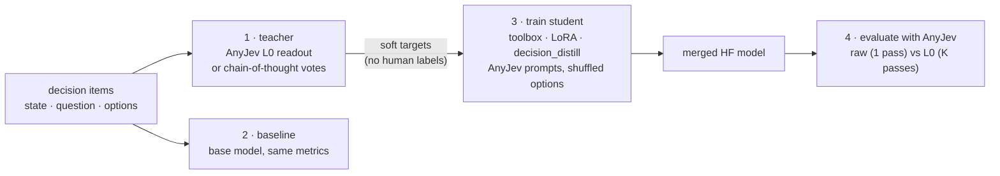

# Jev decision models: train with toolbox, read out with AnyJev

A **Jev-style decision model** answers a typed question (pick an option, yes/no, a score)
with a **probability per option**, read from the next-token logits of the answer labels instead of
parsed from generated text. [AnyJev](https://github.com/nokia-applied-research/AnyJev) provides
the inference side: a training-free readout (`Decider`, level `L0`) that averages over option
permutations to remove position and label bias, and a runtime for its self-distilled `Tacit`
models. It doesn't ship a training pipeline. This example is that pipeline: **any base LLM →
a decision model that gives the debiased (or reasoned) decision in one forward pass**.

> Nokia Applied Research. *AnyJev: typed decisions with real probabilities from any open LLM.*
> <https://github.com/nokia-applied-research/AnyJev> (Apache-2.0), used here as the `anyjev`
> package. Not affiliated with or endorsed by its authors.

## How it works



| Stage | Who does it | Notes |
| --- | --- | --- |
| Teacher labels | **AnyJev** `Decider(level="L0")` ([`teacher.py`](teacher.py)), or chain-of-thought votes | `--teacher l0` (default) or `--teacher cot`. A bigger `--teacher-model` gives distillation; the same model gives self-distillation |
| Prompts and labels | **AnyJev** `build_prompt`, `render_chat`, `resolve_labels` ([`data.py`](data.py)) | the student is trained on exactly the prompts AnyJev serves, so no adapter is needed afterwards |
| Training | **toolbox** `supervised` trainer, `decision_distill` objective, `hf_causal_lm` with LoRA ([config](configs/experiment/jev_student.yaml)) | each example shows the options in a random order; swap in `decision_ce` (gold labels) or `decision_pg` (rewards only) |
| Evaluation | **AnyJev** `Decider` on the saved student ([`evaluate.py`](evaluate.py)) | accuracy, teacher agreement, flip rate under option reversal, calibration (ECE), forward passes |

## Run it

```bash
pip install -e ".[jev]"     # anyjev[hf] + transformers + peft
python -m examples.jev.run                                            # 0.5B self-distillation
python -m examples.jev.run --teacher-model Qwen/Qwen2.5-1.5B-Instruct # 1.5B teacher → 0.5B student
python -m examples.jev.run --teacher cot --samples 8                  # chain-of-thought teacher
python -m examples.jev.run --data data/processed/my_decisions.jsonl trainer.max_steps=500
pytest examples/jev                                                   # tests (AnyJev FakeBackend)
```

Data is JSONL with `state`, `question`, `options` and optionally `answer` (only used for
reporting accuracy; training needs no labels). Each stage caches its output in `--out`
(`teacher.jsonl`, `student/`, `results.json`); delete a file to redo that stage. The student is a
plain Hugging Face model, so serving it is `Decider(HFBackend("runs/jev/student"))`.

## Results

Qwen2.5-0.5B-Instruct student, 256 items from the bundled `decisions.jsonl` (arithmetic yes/no
and "which is larger" questions), 150 LoRA steps on an Apple M-series GPU, evaluated on the 51
held-out items:

| Model · readout | Accuracy | Agreement with teacher | Flip rate | ECE | Forward passes |
| --- | --- | --- | --- | --- | --- |
| base 0.5B · raw | 0.471 | 0.569 | 0.529 | 0.357 | 1 |
| base 0.5B · L0 | 0.431 | 0.647 | 0.000 | 0.301 | 2 |
| teacher 1.5B · L0 | 0.784 | — | — | — | 2 |
| **student 0.5B · raw** | **0.804** | 0.980 | **0.000** | **0.198** | **1** |

* **The student does in one pass what the teacher needed K passes for.** It agrees with the
  1.5B teacher on 98% of held-out items and matches its accuracy, at the 0.5B model's cost and
  with a single forward pass.
* **Position bias is gone.** The base model changes its answer for 53% of items when the options
  are reversed; the student changes it for none, because training showed the options in random
  order.
* **Calibration improves** (ECE 0.36 → 0.20): the probabilities are closer to real correctness
  rates.

With the 0.5B model as its own teacher, the student again matched its teacher (100% agreement,
flip rate 0.53 → 0) but not better than the teacher's 43% accuracy. Self-distillation removes
bias and saves passes; it doesn't add knowledge the teacher lacks. That's why a stronger
teacher, or the CoT teacher, is the useful setting.

**Caveats:** 51 held-out items from one synthetic task, single seed, so treat these as a
working demonstration, not a benchmark. With two options L0 costs only 2 passes. The saving
grows with the number of options. Run the pipeline on your own decision data for real numbers.

## What is and isn't covered

Covered:
- Teacher labelling with AnyJev's L0 readout or chain-of-thought votes.
- Student training in AnyJev's prompt format, with option shuffling and LoRA.
- A merged Hugging Face model that AnyJev can serve.
- Evaluation of accuracy, agreement, flip rate, ECE and forward passes.

Not covered:
- AnyJev's adaptive rotation budget and CoT escalation at serving time (use AnyJev's `Tacit` /
  `Decider` options directly).
- Score and yes/no ("noul") questions in the bundled data; the code accepts them, but the
  numbers above are choice questions.
- Reproducing AnyJev's published Tacit checkpoints or benchmarks.
