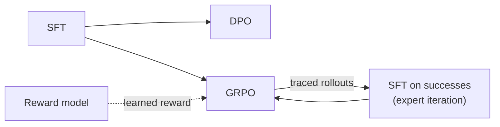

# Recipes: end-to-end workflows

Short workflows built only from the public API and configs. Copy one, change it, run it. All of
them run on a laptop CPU in a minute or two with the tiny models. On a GPU, switch to
`model=qwen2_5_0_5b_lora tokenizer=qwen2_5` for real results.

| Recipe | Run | What it shows |
| --- | --- | --- |
| [`rlhf_pipeline.sh`](rlhf_pipeline.sh) | `bash examples/recipes/rlhf_pipeline.sh` | SFT → reward model → DPO and GRPO (verifiable *and* learned reward), each stage starting from the previous one |
| [`self_improve.py`](self_improve.py) | `python -m examples.recipes.self_improve` | expert iteration: alternate GRPO rounds with SFT on the policy's own successful, traced rollouts |
| [`agent_tracing.py`](agent_tracing.py) | `python -m examples.recipes.agent_tracing` | log an agent's decisions as atomic actions, attach delayed rewards, then train a decision model on the log |
| [`custom_objective.py`](custom_objective.py) | `python -m examples.recipes.custom_objective` | register a new loss and train with it, without touching toolbox code |
| [`custom_layer.py`](custom_layer.py) | `python -m examples.recipes.custom_layer` | replace model internals (a transformer feed-forward, a GNN head) with your own layers and compare with the built-ins |

The first two together form the usual post-training loop. Every stage starts from the previous
checkpoint with `model.init_from`:

